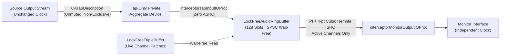

# Interceptor

Passive, zero-exclusivity Core Audio stream tap and discrete mono channel monitor router for macOS.

[](https://github.com/sbacaro/Interceptor)
[](https://swift.org)
[](https://github.com/sbacaro/Interceptor)
[](https://github.com/sbacaro/Interceptor/releases/latest)
[](./LICENSE)

---

## Overview

DAWs such as Pro Tools rely on a single Playback Engine and strict hardware clock ownership, making it difficult to monitor through a separate audio interface without system-wide aggregate devices or third-party virtual audio drivers that introduce clock instability.

**Interceptor** passively taps any Core Audio output stream (`AudioHardwareCreateProcessTap` + `CATapDescription`) directly inside `coreaudiod` — **unmuted (`CATapUnmuted`), non-exclusive, and without touching the source interface's clock or Playback Engine** — and routes discrete mono channels (`Ch 1…N → Out 1…M`) to any monitoring interface over an isolated private bridge with real-time PI-controlled drift compensation.

## Key Features

- **100% Interface-Agnostic**: Works with any Core Audio output interface (USB, Thunderbolt, PCIe, Network/Dante/AVB, Virtual Bridges, Built-in) across single-stream and multi-stream devices up to 128 channels.
- **Virtual Devices Organization**: Create multiple independent routing bridges (e.g., *Main Monitor*, *Headphones*) and run them simultaneously with automatic JSON persistence.
- **Discrete Mono Channel Patching**: Patch any source output channel (`Ch 1…N`) to any monitor output channel (`Out 1…M`) at unity gain (bit-transparent when clocks match), with live lock-free edits and GPU-composited (`CALayer`) dBFS VU meters with click-to-clear clip indicators.
- **Zero-Allocation Real-Time Audio Engine**: Decoupled C `AudioDeviceIOProc` trampolines backed by a 128-slot planar `LockFreeAudioRingBuffer` (`16,384` frames), PI-controlled 4-point cubic Hermite drift compensation & sample-rate conversion on active routed channels only, wait-free `LockFreeTripleBuffer` (`Synchronization.Atomic`) routing snapshots, and lock-free atomic metering (`AtomicMeterBank`).
- **Optional Process Scope**: Tap all processes outputting to the source stream (always excluding Interceptor itself via process ID and bundle ID) or target a single commercial application with automatic bundle-ID restoration across restarts.
- **Native macOS Integration**: Menu Bar companion mode when the main window closes, Launch at Login (`SMAppService`), hot-plug reconnection, sample-rate/buffer-size change recovery, and built-in GitHub Releases updater.

## Requirements

| Use Case | Requirement |
| :--- | :--- |
| **Running Interceptor** | **macOS 26.0** or later (Apple Silicon & Intel Universal) |
| **Audio Capture Permission** | **System Audio Recording Only** (*System Settings → Privacy & Security*) |
| **Building from Source** | **Xcode 27.2+** / **Swift 6** |

## Installation

### Prebuilt Binary (Recommended)

1. Download the latest `.zip` archive from [GitHub Releases](https://github.com/sbacaro/Interceptor/releases/latest).
2. Extract the archive and move `Interceptor.app` into `/Applications`.
3. Launch **Interceptor** and grant **System Audio Recording** permission when prompted.

> [!IMPORTANT]
> **Why System Audio Recording permission is required:** Interceptor uses macOS's native Core Audio Process Tap API (`CATapDescription`) to read output streams passively inside `coreaudiod`. It does not activate or request microphone/line-in capture on your monitoring interface.

### Build from Source

```bash
git clone https://github.com/sbacaro/Interceptor.git
cd Interceptor

# Run the Swift Testing suite
DEVELOPER_DIR=/Applications/Xcode.app/Contents/Developer \
  xcodebuild test -project Interceptor.xcodeproj -scheme Interceptor \
  -destination 'platform=macOS' -derivedDataPath /tmp/InterceptorDerivedData

# Build Release Universal app outside the repository
DEVELOPER_DIR=/Applications/Xcode.app/Contents/Developer \
  xcodebuild build -project Interceptor.xcodeproj -scheme Interceptor \
  -configuration Release -destination 'platform=macOS' \
  -derivedDataPath /tmp/InterceptorDerivedData
```

<details>
<summary>Alternative: open directly in Xcode</summary>

1. Open `Interceptor.xcodeproj` in Xcode.
2. Select the **Interceptor** scheme.
3. Press `⌘R` to run or `⌘U` to run the test suite.

</details>

## Quick Start

1. Select a **Virtual Device** in the sidebar (or press `⇧⌘N` to create a new bridge).
2. Choose your **Source** playback interface and optional **Process Scope** (*All Processes* or a specific application).
3. Choose your **Monitor** destination interface.
4. Add or edit mono channel patches (`Ch 1 → Out 1`, `Ch 2 → Out 2`, etc.) and press `⌘R` (**Intercept**).

### Keyboard Shortcuts

| Shortcut | Action |
| :--- | :--- |
| `⌘R` | Start / Stop selected bridge (`Intercept` / `Stop`) |
| `⌥⌘R` | Stop all active bridges |
| `⌘N` | Add mono channel patch to selected bridge |
| `⇧⌘N` | Create new virtual routing bridge |
| `⇧⌘R` | Refresh Core Audio interfaces & active applications |
| `⌘I` | Toggle Bridge Info popover (rates, latency, XRuns) |
| `⌘,` | Open Settings |

## Architecture



### Project Layout

| Module | Purpose |
| :--- | :--- |
| [InterceptorEngine](./InterceptorEngine) | Core Audio device/process catalog, passive tap bridge, lock-free RT router, ring/triple buffers, atomic meters, and JSON persistence |
| [Interceptor](./Interceptor) | Native SwiftUI & AppKit macOS app, Menu Bar companion, Core Animation VU meters, Settings, and GitHub Releases self-updater |
| [InterceptorEngineTests](./InterceptorEngineTests) | Swift Testing suite covering RT routing, ring buffer priming/SRC, atomic meters, route validation, and persistence |

## Troubleshooting

- **Permission Required banner or silent meters**: Ensure **Interceptor** is enabled in *System Settings → Privacy & Security → System Audio Recording Only*, then click **Retry**.
- **Same interface selected for Source and Monitor**: Route to distinct output channel numbers to avoid double monitoring; Interceptor always excludes its own process from global taps to prevent feedback loops.
- **Disconnected interface**: If *Automatically reconnect interfaces after disconnect* is enabled in Settings (`⌘,`), active bridges enter *Waiting* state and resume automatically as soon as the interface reconnects.

## Support & Contributing

- Bug reports and feature requests: [GitHub Issues](https://github.com/sbacaro/Interceptor/issues)
- Before opening a pull request, please verify all unit tests in [InterceptorEngineTests](./InterceptorEngineTests) pass without warnings.

## License

This project is licensed under the **PolyForm Noncommercial License 1.0.0** (`PolyForm-Noncommercial-1.0.0`) — see the [LICENSE](./LICENSE) file for the full terms.

> **Required Notice:** `Copyright © 2026 Samuel Bacaro`

In plain terms, Interceptor is free to use, modify, and share for **personal, educational, research, and other noncommercial purposes**. Any commercial use requires a separate commercial license — please open an issue on [GitHub Issues](https://github.com/sbacaro/Interceptor/issues) to inquire.
